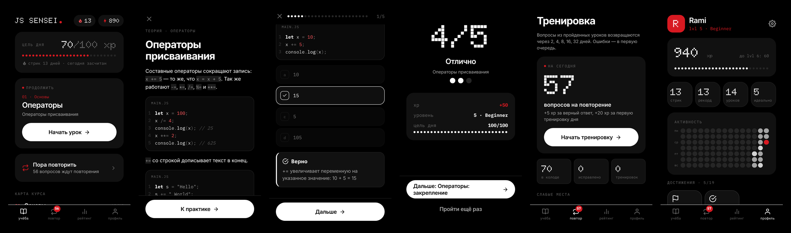

# ⚡ JS Sensei

Мобильное приложение для изучения JavaScript по 5 минут в день: короткая теория, практика на реальном коде и интервальные повторения, чтобы знания не выветривались.



## Возможности

- **Уроки «теория → практика → разбор».** Карточка с концепцией и примером кода, затем 5–6 вопросов: «что выведет код», «верно или нет», «заполни пропуск», «расставь строки», «найди баг». После каждого ответа — объяснение и разбор именно твоей ошибки.
- **Тренировка с интервальными повторениями.** Каждый вопрос возвращается через 2, 4, 8, 16 и 32 дня, ошибки — в первую очередь. Список слабых мест.
- **Задача дня.** Один вопрос в день, одинаковый для всех, одна попытка, серия решённых задач и карточка результата, которой можно поделиться без спойлеров.
- **Запуск кода.** После ответа и под примерами в теории кнопка «Запустить» выполняет код в песочнице и показывает настоящий вывод консоли — объяснение можно проверить самому.
- **Вводный тест** для тех, кто уже знает основы: знакомые темы засчитываются, курс продолжается с первой незнакомой.
- **Честная геймификация.** XP только за новое (повтор урока без улучшения XP не даёт), уровни и звания, цель дня, стрик по локальному времени с заморозками, 19 достижений.
- **Умные напоминания.** Локальные уведомления в выбранное время; если уже занимался сегодня — не беспокоят, если стрик под угрозой — предупреждают.
- **Рейтинг** по желанию: ник, недельный и общий зачёт, анонимная авторизация и правила базы против накрутки.
- **Тёмная тема**, подсветка синтаксиса, звуки и вибрация (отключаются).

## Стек

Expo SDK 54 · React Native 0.81 · TypeScript · expo-router · zustand (persist + миграции) · zod · Jest · Firebase Realtime Database (REST).

## Запуск

```bash
npm ci
npm start          # Expo Dev Server: QR-код для Expo Go
npm run web        # веб-версия в браузере
```

Проверки (то же самое запускает CI на каждый PR):

```bash
npm run check      # typecheck + lint + format + тесты + валидация контента
```

E2E-тесты интерфейса (Playwright, мобильный вьюпорт) собирают веб-версию в `dist-e2e` и проходят основные сценарии: онбординг, урок, повторение, вводный тест, миграцию сохранённых данных. В CI это отдельная задача `e2e`.

```bash
npx playwright install chromium   # один раз
npm run test:e2e
```

## Архитектура

```
app/                    экраны (expo-router): вкладки, урок, тренировка, тест, настройки
content/                учебный контент в JSON + реестр разделов (см. content/README.md)
src/content/            zod-схема контента и репозиторий для чтения
src/domain/             бизнес-логика без React: XP, уровни, стрик, достижения,
                        интервальные повторения, напоминания, миграции — покрыта тестами
src/features/quiz/      сессия вопросов: стейт-машина, реестр типов вопросов, разбор ответа
src/features/…          теория, экран результата
src/stores/             единый persisted-стор (настройки + прогресс) с версионированием
src/services/           уведомления, звук/вибрация, рейтинг, Firebase-авторизация,
                        песочница для запуска кода (WebView, на вебе — Worker)
src/ui/                 токены темы и UI-кит (кнопки, карточки, код с подсветкой)
scripts/                валидатор контента: схема, связи и запуск кода из вопросов
```

Принципы:

- **Правила — в `src/domain`.** Чистые функции, стор только сохраняет состояние и вызывает их. Всё, что влияет на XP и прогресс, проверено юнит-тестами.
- **Контент отделён от кода.** Новый раздел — это JSON-файл, запись в `sections.json` и строка в `content/index.ts`. Схема одна для приложения и валидатора.
- **Новый тип вопроса** — компонент и запись в `src/features/quiz/registry.ts` плюс вариант в схеме.
- **Изменение формы сохранённых данных** — новая версия в `useUserStore` и миграция, чтобы не потерять прогресс пользователей.

## Контент

Формат уроков и правила написания — в [`content/README.md`](./content/README.md). Валидатор `npm run validate:content` проверяет схему и выполняет код каждого вопроса «что выведет код», сверяя вывод с правильным ответом.

## Рейтинг и Firebase

Как включить защиту рейтинга (анонимный вход + правила базы) — в [`docs/firebase.md`](./docs/firebase.md).

## Сборка

```bash
npm run build:android   # EAS Build
npm run build:ios
```
